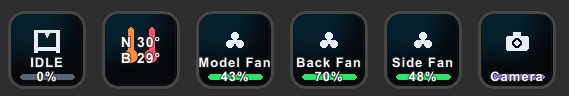
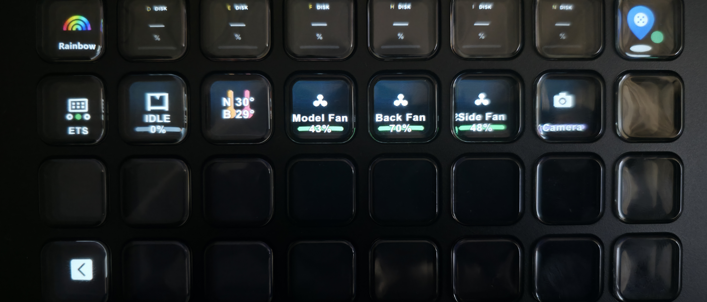
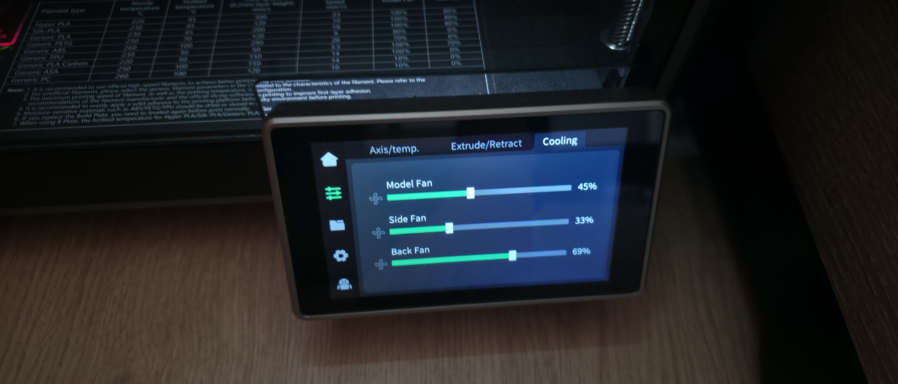

# Creality Monitor — Stream Deck plugin





Live print status, temperatures, fan control and camera preview for a **Creality K-series
printer** (K1 / K1C / K1 Max), straight on your Stream Deck.

**[Get it on the Elgato Marketplace](https://marketplace.elgato.com/product/creality-monitor-91672b97-4ec5-45ca-86a5-517038f739d3)** — free.

Sibling project to [`CrealityCorsairWidget`](https://github.com/tunev/creality-monitor-icue) (the Corsair iCUE
widget version of the same monitor) — both talk to the printer's local API on port `9999`
using the same connection/merge logic, so behavior should feel consistent across both.

## Actions

| Action | What it does |
| --- | --- |
| **Print Status** | While printing: progress %, current layer and time remaining. Otherwise: the state (IDLE / PAUSED / DONE / FAILED / OFFLINE) and progress %. The key icon accent color follows the state. |
| **Nozzle Temp** | Live nozzle temperature, current → target. |
| **Bed Temp** | Live bed temperature, current → target. |
| **Fan Control** | Press to turn the Model, Back (Case) or Side (Auxiliary) fan on or off; the key shows the live fan percentage when it's on. |
| **Camera** | Key shows ONLINE / OFFLINE; open the action's property inspector (gear icon) for a live WebRTC video preview of the printer's camera. |

All actions have a **Printer IP / host** and **Port** field in their property inspector
(defaults to `192.168.0.232:9999`) so you can point each key at a different printer if you
own more than one. Keys pointed at the same host share a single WebSocket connection.

The **Camera** action has one extra field, **This PC IP (camera)**: enter this computer's LAN IP
there (see [Protocol notes](#protocol-notes) for why).

**Fan Control sends real commands to the printer** (`{"method":"set","params":{...}}`) —
the other actions are read-only.

## Requirements

- Stream Deck software 7.1+ (tested on a **Stream Deck XL**)
- A Creality K1 / K1C / K1 Max on the same local network (developed and tested on a K1C)
- Node.js 20+ (only needed to build the plugin, not to run it)

## Setup

```powershell
npm install
npm run build
npx @elgato/cli link com.tunev.crealitymonitor.sdPlugin   # one-time: tells Stream Deck about the plugin
```

Then open the Stream Deck app, find **Creality Monitor** in the actions list, and drag any
of the five actions onto a key. The plugin process only starts once a key is placed —
that's normal Stream Deck SDK behavior, not a bug.

## Development

```powershell
npm run watch   # rebuilds on save and restarts the plugin automatically
```

Logs are written to `com.tunev.crealitymonitor.sdPlugin/logs/`.

## Protocol notes

The printer pushes a full state snapshot on connect, then only the fields that changed —
so the plugin merges incoming messages into a running state object instead of replacing
it. There is no server-side heartbeat, so the plugin sends
`{"ModeCode":"heart_beat","msg":"<unix seconds>"}` every 5 seconds to keep the socket alive
and detect silently-dead connections. See [`src/printer-client.ts`](src/printer-client.ts)
for the full implementation.

The fan **read** (telemetry) field names differ from the fan **set** (command) field
names — `fan` / `fanCase` / `fanAuxiliary` are the SET params, but the live on/off and
percentage must be read from `modelFanPct` / `caseFanPct` / `auxiliaryFanPct`. Don't
assume the two are the same key; this bit us once (Side Fan silently always read OFF)
and is now fixed via the `FAN_READ_FIELD` map in `printer-client.ts`. Note the spelling
`fanAuxiliary` (two L's): the same string is used as the option value in `ui/fan.html`,
so a typo in either place silently falls back to the Model fan.

The camera preview re-uses the widget's WebRTC signaling flow (token request over the
status WebSocket, then an SDP offer/answer POST to `http://<host>:8000/call/webrtc_local`)
and only runs in the property inspector's Chromium webview — the physical key itself has
no video codec support, so it only ever shows a static icon + online/offline state.
Chromium hides the local IP behind an mDNS name that the printer can't resolve, so the
SDP offer's `*.local` address is replaced with the **This PC IP (camera)** value.

## Roadmap

- **v1.0:** read-only monitoring (status, temperatures).
- **v1.1 (this release):** fan control, camera preview in the property inspector,
  separate Nozzle and Bed keys, WebSocket teardown crash fix.
- **Planned:** pause / resume / stop, validated live against a real K1C before shipping —
  some control commands referenced in community docs use an unconfirmed message format
  and must not be trusted blindly.
